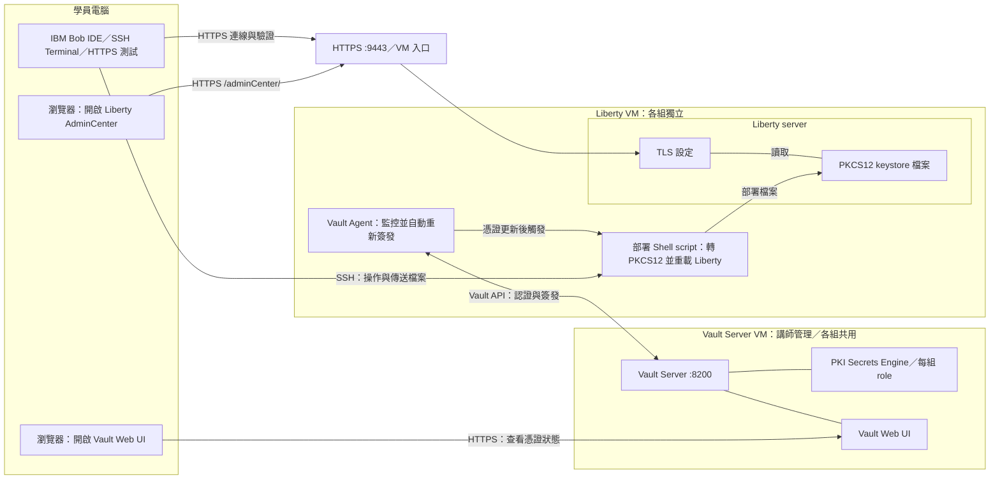

# Scenario 1｜Vault PKI ＋ Vault Agent

[← 回總覽](../README.md) · [開啟分頁教材](../index.html#part-1)

**難度：進階｜總時間：60 分鐘｜適合：想理解 Vault 持續換證與事件觸發的 SP／OP**

## 主機部署架構



Bob 在學員電腦使用；部署工具與 Liberty 在該組 VM 執行。學員可透過瀏覽器開啟講師提供的 Vault UI 網址，查看權限內的憑證狀態。

## 操作前準備

在 Bob IDE Terminal 登入自己的 Liberty VM，以第 1 組為例：

```bash
# 在學員電腦查詢該組 SSH config 的有效 HostName；此例為第 1 組
ssh -G liberty1 | awk '$1 == "hostname" {print $2; exit}'
# 記下輸出的 VM IP，再登入同一台 VM
ssh liberty1
# 以下在 Liberty VM 執行，自行建立本課工作目錄
# 把 <你的名字> 換成自己的英文名，例如 alice → ~/workshop-alice
mkdir -p ~/workshop-<你的名字>
cd ~/workshop-<你的名字>
hostname
whoami
/opt/ibm/wlp/bin/server status defaultServer
openssl version
```

每位學員請建立**自己的資料夾**（避免 4～5 人共用同一台 Liberty VM 時互相覆蓋檔案）。下文以 `/home/vpcuser/workshop-<你的名字>/` 代表你的工作目錄，請換成實際路徑，例如 `/home/vpcuser/workshop-alice/`。
`~/clm-workshop/` 是講師備妥的共用素材（Vault CA、Token、CA 鏈），**只讀取，不要在裡面放自己的檔案**。

以下資料已為你備妥：

| 項目 | 內容 |
|---|---|
| Vault 位址 | `https://128.168.136.176:8200`（`export VAULT_ADDR=https://128.168.136.176:8200`） |
| Vault 的 CA | `/home/vpcuser/clm-workshop/vault-api-ca.pem`（Vault 使用自簽憑證）；`VAULT_CACERT` 已寫入 `~/.bashrc`，重新登入或 `source ~/.bashrc` 後生效 |
| Vault Token | `/home/vpcuser/clm-workshop/vault-token`（權限 0600，有效一週）；只從檔案讀取，不要回顯或貼進對話 |
| PKI mount | `pki_int`（Workshop Intermediate CA；Root 為 Workshop Root CA） |
| 簽發 role | `liberty-server`：允許 IP SAN、不需 CN；預設 TTL 1 小時、上限 168 小時，申請時可用 `ttl` 指定較短值（例如 3 分鐘） |
| 簽發 policy | `pki-issue` |
| 驗證用 CA 鏈 | `/home/vpcuser/clm-workshop/pki-ca-chain.pem`（Root＋Intermediate），即 `check_cert` 的 `CA_FILE` |

AppRole 由你在步驟 2 自行建立（policy 用 `pki-issue`）：Role ID 與 Secret ID 各存成 0600 本機檔案，Secret ID 是 Agent auto-auth 使用的認證，值不要貼進對話。

**先讓 Bob 確認實際環境：**

```text
請先確認實際環境，只讀公開憑證與設定，不顯示私鑰或密碼：
1. 檢查 Liberty server.xml：HTTPS、port、keystore 設定，以及服務控制方式。
2. 讀取目前憑證的 SAN。
3. 列出本情境所需檔案與認證的位置；缺少的先指出缺項，不要假設存在 env.sh、程式骨架或參考完成檔。

工作目錄是 ~/workshop-<你的名字>；Agent 用 HCL 指定實際路徑，hook 使用明確參數。請依確認結果給完整執行命令。
```

缺少 CA、role 或認證資料時，先向講師確認。後續程式與設定檔須先讓 Bob 產生、檢視，再執行。

### 部署前確認、部署後驗證

**Liberty 目前已啟用 HTTPS，送出的是預設自簽憑證（`CN=localhost`，無 IP SAN）；本課要把它換成新憑證。** 部署前先用 `record_baseline` 記錄舊序號；部署完成後，用 `check_cert` 確認服務送出的是本次產生的憑證。

**Liberty VM IP 的取得與使用：**

- 在學員電腦用前面的 `ssh -G liberty1` 查詢（其他組換自己的編號）。
- 把輸出的 IP 用於憑證 IP SAN 與驗證用的 `TLS_HOST`；另加入 `127.0.0.1` IP SAN 供本機測試。
- 不要把 SSH 別名當 IP；VM 內也不要假設有相同的 SSH config。
- 不需要 DNS 名稱或 DNS challenge。

**給 Bob 的部署要求：**

```text
請依以下條件建立部署流程：

【現況】
- Liberty 已啟用 HTTPS，現有 resources/security/key.p12 是預設自簽憑證（CN=localhost）。
- 第一次部署就必須換成本次新憑證，不能因為已有憑證而 skip；之後的輪換才做到期判斷。

【憑證】
- IP SAN 包含 SSH config 查到的 Liberty VM IP 與 127.0.0.1。
- 不使用 DNS challenge，不要求真實 DNS 名稱。

【路徑與權限】
- 所有產出（憑證、金鑰、腳本、日誌）放在 /home/vpcuser/workshop-<你的名字>/，腳本一律用這個絕對路徑，不用 ~ 或 $HOME（cron 以 root 執行，root 的 HOME 是 /root）。
- 所需路徑明確傳入腳本或設定，不依賴未提供的設定檔。
- 公開憑證 0644（vpcuser 要能讀來驗證），私鑰 0600。

【Liberty 與 keystore】
- Liberty 以 root 執行；server.xml、server.env、resources/security/key.p12 都是 root 所有。
- vpcuser 可免密碼 sudo；讀寫與重啟 Liberty 都用 sudo（cron 內也要）。
- key.p12 的密碼在 server.env 的 keystore_password（server.xml 以 ${keystore.password} 引用）。新 PKCS12 沿用同一密碼並放回原路徑；只在腳本內讀取，不輸出、不寫進日誌。
- 替換前先備份舊 key.p12；若要改 server.xml 也先備份，保留其他功能與連接埠設定。

【驗證】
- 啟動後比對線上與本次產出的 leaf 憑證指紋，並驗證 CA 信任與 IP SAN。
```

**驗證函式使用方式：**

- 在 Liberty VM 的 Terminal 定義一次。
- `record_baseline` 在步驟 1 使用；`check_cert` 在部署完成後使用。
- 執行 `check_cert` 前，先確認 CA 與本次 leaf 的檔名與實際輸出一致。
- 這些變數只供驗證使用。

<details>
<summary>展開設定與驗證函式：record_baseline／check_cert</summary>

```bash
set -o pipefail
TLS_HOST='填入學員電腦SSH config查到的Liberty VM IP'
TLS_PORT=9443 # 以實際設定為準
CA_FILE='/home/vpcuser/clm-workshop/pki-ca-chain.pem'
LEAF_FILE='/home/vpcuser/workshop-<你的名字>/server.crt' # 部署時由 hook 拆出的 leaf；以 Bob 產出的實際檔名為準

record_baseline() (
  set -o pipefail
  # 僅記錄公開資訊，不宣稱舊憑證已通過信任驗證
  if timeout 10 openssl s_client -connect "${TLS_HOST}:${TLS_PORT}" \
      </dev/null 2>baseline-tls.log \
      | openssl x509 -noout -serial -issuer -dates > before.tmp; then
    mv before.tmp before.txt
    cat before.txt
  else
    rm -f before.tmp before.txt
    echo '無法取得線上憑證：請確認 Liberty 已啟動、TLS_HOST 與 TLS_PORT 正確，並查看 baseline-tls.log。'
  fi
)

check_cert() (
  set -euo pipefail
  : "${TLS_HOST:?}" "${TLS_PORT:?}" "${CA_FILE:?}" "${LEAF_FILE:?}"
  peer=$(timeout 10 openssl s_client \
    -connect "${TLS_HOST}:${TLS_PORT}" -verify_ip "$TLS_HOST" \
    -CAfile "$CA_FILE" -verify_return_error \
    </dev/null 2>tls-check.log | openssl x509 -outform PEM)
  expected=$(openssl x509 -in "$LEAF_FILE" -noout -fingerprint -sha256)
  actual=$(printf '%s\n' "$peer" | openssl x509 -noout -fingerprint -sha256)
  [ "$expected" = "$actual" ] || { echo '線上憑證與本次產出不一致' >&2; exit 1; }
  printf '%s\n' "$peer" | openssl x509 -noout -serial -subject -issuer -dates -ext subjectAltName
  echo '驗證通過：TLS、CA 信任、IP SAN 與本次憑證指紋一致'
)
```

</details>

- `record_baseline` 無法取得憑證：先看設定與 `baseline-tls.log`，不直接認定憑證過期或信任有誤。
- `check_cert` 失敗：查看 `tls-check.log`；不能用忽略驗證的方式當作完成。

### Vault 簽發設定

role `liberty-server` 已設定 `allow_ip_sans=true`、`require_cn=false`，簽發請求只要帶 `ip_sans`（SSH config 查到的 VM IP 與 `127.0.0.1`），不強制 CN，也沒有 DNS challenge。role 為各組共用，請勿修改。

**標示簽發者：** 為了從憑證看出是誰簽發的，簽發時請另帶 `common_name=<你的名字>-liberty<組別>`（例如 `alice-liberty1`），它會寫入憑證的 CN（Vault 也會順帶放進 DNS SAN）。O／OU 由 role 統一設定、無法在簽發時各自指定，所以用 CN 標示。

## 實作流程

### 1. 辨識現況｜5 分鐘

> **主責角色：** 🤖 AP／維運（檢查 HTTPS／keystore、記錄預設憑證序號）｜**協作：** 🔐 憑證管理者（確認連得到 Vault）、📑 統整報告員（記錄舊序號與架構）

檢查 HTTPS／keystore 設定，記錄預設憑證的序號，並確認連得到 Vault。確認 Agent 尚未執行。

**給 Bob 的提示：**

```text
我是 SP／OP 人員，請先簡要解釋：
1. TLS 憑證生命週期的申請、核發、部署、監控、輪換與撤銷。
2. Liberty 的 JKS 與 PKCS12 有何差異，本次為何選 PKCS12。
3. 自動輪換與手動置換的風險差異。
4. Vault PKI Secrets Engine 在 CLM 的角色，以及 role 如何限制簽發。
5. Vault Agent 如何取得認證並自動重新簽發憑證。

再根據本次環境：
請畫出 Vault PKI、Vault Agent、deploy-hook.sh 與 Liberty 的關係，指出每個元件負責什麼。
```

**操作指令（Liberty VM）：**

```bash
vault version
vault status   # 確認連得到 Vault；若報 certificate 錯誤，先 source ~/.bashrc
record_baseline
```

**檢查點：** 取得舊憑證序號（`record_baseline` 輸出）。

### 2. 完成 Agent 設定｜12 分鐘

> **主責角色：** 🔐 憑證管理者（建立 AppRole、設定 Agent 的 pkiCert template）

分兩段：2a 用你的 Vault Token 建立本組 AppRole（policy 只需 PKI 簽發權限），Role ID、Secret ID 存成 0600 檔案；2b 請 Bob 產生 auto-auth 與 template 設定。

**給 Bob 的提示：**

```text
【2a 建立 AppRole】
- 用 /home/vpcuser/clm-workshop/vault-token 建立本組 AppRole。
- policy 用 pki-issue（只允許 pki_int/issue/liberty-server 簽發）。
- Role ID、Secret ID 各寫入 /home/vpcuser/workshop-<你的名字>/ 下的 0600 檔案，不要顯示值。

【2b 產生 Agent 設定】
- 產生 liberty-agent.hcl 與 template，路徑一律用 /home/vpcuser/workshop-<你的名字>/ 絕對路徑。
- auto-auth 的 AppRole ID／Secret ID 只讀取本機檔案，不要將值寫進回覆。
- pkiCert 簽發時帶 common_name=<你的名字>-liberty<組別>（標示簽發者）、ip_sans 與 ttl。
- 使用 pkiCert，單次簽發輸出同一份 PEM bundle（leaf、私鑰、CA 鏈）；不要把私鑰分成獨立簽發的 template。
- hook 指向 deploy-hook.sh（步驟 3 建立），只在成功渲染後執行；設定執行逾時。
```

**操作指令（Liberty VM）：**

```bash
vault agent -help
# 請 Bob 產生 HCL 與 template，再檢視檔案內容
# 不要用 cat 回顯 role-id／secret-id 等秘密檔案
```

**檢查點：** 可啟動的 HCL 與 template。

### 3. 補完部署 hook｜15 分鐘

> **主責角色：** 🤖 AP／維運（拆 bundle、轉 PKCS12、替換 keystore、重啟 Liberty、失敗還原）

由 Bob 補齊 bundle 拆分、PKCS12 轉換及部署驗證，沿用已確認的 Liberty 控制方式。

**給 Bob 的提示：**

```text
請產生 deploy-hook.sh，需求如下：
- Agent 以 vpcuser 執行；hook 內讀寫 Liberty 檔案與重啟 Liberty 都要用 sudo。
- 使用互斥鎖。
- 把部署的 leaf 憑證另存為 /home/vpcuser/workshop-<你的名字>/server.crt（0644），供 check_cert 比對。
- 從單一 bundle 拆出配對的 key／cert／chain，驗證私鑰與憑證公鑰一致及憑證鏈。
- 在暫存目錄轉成 PKCS12，再備份並原子替換 live keystore。
- 明確處理每一步失敗；只有內容變更時才受控重啟 Liberty。
- 驗證失敗就還原舊 keystore 並恢復服務。
- 不輸出秘密。
```

**操作指令（Liberty VM）：**

```bash
bash -n ./deploy-hook.sh
chmod 700 ./deploy-hook.sh
# hook 由 Agent 成功渲染後觸發，勿在 bundle 尚未產生前執行
```

**檢查點：** 語法通過的 deploy-hook.sh（首次部署會在步驟 4 啟動 Agent 時發生）。

### 4. 觀察自動輪換｜13 分鐘

> **主責角色：** 🔐 憑證管理者（啟動 Agent、指定 `ttl=3m`、確認重新簽發）｜**協作：** 🤖 AP／維運（用 `check_cert` 觀察線上序號）

啟動 Agent，在 template 的 pkiCert 指定 `ttl=3m`（role 上限 168 小時，3 分鐘可行），持續觀察約兩個週期及線上憑證序號。

**給 Bob 的提示：**

```text
請檢查 Agent log、template 與 hook 執行紀錄，並：
- 解釋「重新簽發憑證」與「Token renewal」的不同。
- 確認線上序號與 bundle 的 leaf 相同。
- 不要以 Agent 程序存活作為換證成功的依據。
```

**操作指令（Liberty VM）：**

```bash
mkdir -p logs
# 前景執行；以 Ctrl+C 停止。另開 SSH Terminal 觀察線上憑證
vault agent -config=./liberty-agent.hcl 2>&1 | tee logs/agent.log
# 另一個 Terminal 先 設定本頁驗證變數並載入 check_cert 函式
# 每隔約 30 秒呼叫 check_cert，記錄序號變更
```

**檢查點：** 至少一次無人工執行 hook 的線上序號變更。

### 5. 核對自動輪換結果｜10 分鐘

> **主責角色：** 🤖 AP／維運（比對日誌、bundle 與線上序號）｜**協作：** 🔐 憑證管理者（確認簽發紀錄）

比對 Agent log、bundle 與線上憑證，確認至少一次由 Agent 自動觸發的重新簽發及部署。

**給 Bob 的提示：**

```text
請比對 Agent／hook 日誌、bundle 憑證序號與線上序號：
- 整理簽發、部署、驗證三個時間點。
- 說明 AppRole Token renewal 與憑證重新簽發的差異。
- 若未觀察到輪換，列出待確認項目；不要把程序存活視為成功。
```

**操作指令（Liberty VM）：**

```bash
# 在另一個 SSH Terminal 重新設定本頁驗證變數並載入 check_cert 函式
check_cert | tee after.txt
tail -n 50 logs/agent.log
# 預設憑證 vs 新憑證：序號應不同
diff -u before.txt after.txt || true
```

**檢查點：** 自動簽發／部署紀錄與線上序號一致。

### 6. 成果交付｜5 分鐘

> **主責角色：** 📑 統整報告員（整理交接）｜**協作：** 🔐 憑證管理者、🤖 AP／維運（提供設定與驗證結果）

停止短 TTL 測試 Agent（或把 template 的 `ttl` 改回 `1h`），提交設定、hook 與部署後憑證資訊（附換證前後序號）。

**給 Bob 的提示：**

```text
請依實際紀錄整理五行交接：架構、觸發條件、驗證方式、失敗保護及未完成事項。
```

**操作指令（Liberty VM）：**

```bash
# 在 Agent 前景 Terminal 按 Ctrl+C 停止 Agent；之後若要保留自動輪換，把 template 的 ttl 改回 1h
check_cert | tee after.txt
# 預設憑證 vs 新憑證：序號應不同
diff -u before.txt after.txt || true
```

**檢查點：** 交接紀錄與測試程序清理。

## Agent 注意事項

PKI leaf 輪換是重新簽發；AppRole Token renewal 是另一件事。短 TTL 測試須確認 role、CA 剩餘效期及 Agent template 行為；若未觀察到自動輪換，記錄未完成事項。

[官方 Agent template 說明](https://developer.hashicorp.com/vault/docs/agent-and-proxy/agent/template)

## 60 分鐘內的完成標準

1. HTTPS 已由預設憑證換成本次憑證，CA 信任、IP SAN 與憑證指紋驗證通過，且序號與換證前（`before.txt`）不同。
2. Agent 自動觸發至少一次重新簽發與部署，日誌及線上序號吻合。
3. 留下程式／設定、部署後憑證資訊（附換證前後序號）與簡短交接，不含秘密。
4. 瀏覽器開啟 `https://<IP>:9443/adminCenter/`（`admin`／`admin123456`），檢視網址列憑證，序號與 `check_cert` 一致；自簽或私有 CA 憑證的瀏覽器警告屬預期。

## 延伸練習（不計入 60 分鐘）

- 使用測試複本或變數觸發錯誤，驗證失敗保護與部署失敗後還原。
- 完整 CA 建置、AGENTS.md、Slash Command、可重用 Skill與多台部署。

## Cheatsheet：實作流程與檢查點

| 時間 | 工作 | 主責 | 檢查點 |
|---|---|---|---|
| 00–05 分 | 辨識現況 | 🤖 AP／維運 | 舊憑證序號（record_baseline 輸出）。 |
| 05–17 分 | 完成 Agent 設定 | 🔐 憑證管理者 | 可啟動的 HCL 與 template。 |
| 17–32 分 | 補完部署 hook | 🤖 AP／維運 | 語法通過的 deploy-hook.sh。 |
| 32–45 分 | 觀察自動輪換 | 🔐 憑證管理者＋🤖 AP／維運 | 至少一次無人工執行 hook 的線上序號變更。 |
| 45–55 分 | 核對自動輪換結果 | 🤖 AP／維運 | 自動簽發／部署紀錄與線上序號一致。 |
| 55–60 分 | 成果交付 | 📑 統整報告員 | 交接紀錄與測試程序清理。 |
