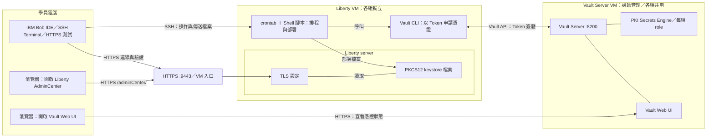

# Part 2｜Vault PKI ＋ Shell／crontab

[← 回組合總覽](../README.md) · [開啟分頁教材](../index.html#part-2)

**難度：中階｜總時間：60 分鐘｜適合：熟悉 Shell、想串接集中式簽發的維運人員**

## 主機部署架構



Bob 在學員電腦使用；部署工具與 Liberty 在該組 VM 執行。學員可透過瀏覽器開啟講師提供的 Vault UI 網址，查看權限內的憑證狀態。

## 操作前準備

在 Bob IDE Terminal 登入自己的 Liberty VM，以第 1 組為例：

```bash
# 在學員電腦查詢該組 SSH config 的有效 HostName；此例為第 1 組
ssh -G liberty1 | awk '$1 == "hostname" {print $2; exit}'
# 記下輸出的 VM IP，再登入同一台 VM
ssh liberty1
# 以下在 Liberty VM 執行，自行建立本課工作目錄
mkdir -p ~/clm-workshop
cd ~/clm-workshop
hostname
whoami
/opt/ibm/wlp/bin/server status defaultServer
openssl version
```

以下資料已為你備妥：

| 項目 | 內容 |
|---|---|
| Vault 位址 | `https://128.168.136.176:8200`（`export VAULT_ADDR=https://128.168.136.176:8200`） |
| Vault 的 CA | `/home/vpcuser/clm-workshop/vault-api-ca.pem`（Vault 使用自簽憑證）；`VAULT_CACERT` 已寫入 `~/.bashrc`，重新登入或 `source ~/.bashrc` 後生效 |
| Vault Token | `/home/vpcuser/clm-workshop/vault-token`（權限 0600，有效一週）；只從檔案讀取，不要回顯或貼進對話 |
| PKI mount | `pki_int`（Workshop Intermediate CA；Root 為 Workshop Root CA） |
| 簽發 role | `liberty-server`：允許 IP SAN、不需 CN；預設 TTL 1 小時、上限 168 小時，申請時可用 `ttl` 指定較短值（例如 3 分鐘） |
| 簽發 policy | `pki-issue` |
| 驗證用 CA 鏈 | `/home/vpcuser/clm-workshop/pki-ca-chain.pem`（Root＋Intermediate），即 `check_cert` 的 `CA_FILE` |

**先讓 Bob 確認實際環境：**

```text
請先確認實際環境，只讀公開憑證與設定，不顯示私鑰或密碼：
1. 檢查 Liberty server.xml：HTTPS、port、keystore 設定，以及服務控制方式。
2. 讀取目前憑證的 SAN。
3. 列出本路線所需檔案與認證的位置；缺少的先指出缺項，不要假設存在 env.sh、程式骨架或參考完成檔。

工作目錄是 ~/clm-workshop；產出腳本用明確參數，Token 從受限本機檔案讀取。請依確認結果給完整執行命令。
```

缺少 CA、role 或認證資料時，先向講師確認。後續程式與設定檔須先讓 Bob 產生、檢視，再執行。

### 部署前確認、部署後驗證

**Liberty 目前已啟用 HTTPS，送出的是預設自簽憑證（`CN=localhost`，無 IP SAN）；本課要把它換成新憑證。** 部署前先用 `record_baseline` 記錄舊序號；部署完成後，用 `check_cert` 確認服務送出的是本次產生的憑證。

**Liberty VM IP 的取得與使用：**

- 在學員電腦用前面的 `ssh -G liberty1` 查詢（其他組換自己的編號）。
- 把輸出的 IP 用於憑證 IP SAN 與驗證用的 `TLS_HOST`；另加入 `127.0.0.1` IP SAN 供本機測試。
- 不要把 SSH 別名當 IP；VM 內也不要假設有相同的 SSH config。
- 不需要 DNS 名稱或 DNS challenge。

**給 Bob 的部署要求：**

```text
請依以下條件建立部署流程：

【現況】
- Liberty 已啟用 HTTPS，現有 resources/security/key.p12 是預設自簽憑證（CN=localhost）。
- 第一次部署就必須換成本次新憑證，不能因為已有憑證而 skip；之後的輪換才做到期判斷。

【憑證】
- IP SAN 包含 SSH config 查到的 Liberty VM IP 與 127.0.0.1。
- 不使用 DNS challenge，不要求真實 DNS 名稱。

【路徑與權限】
- 所有產出（憑證、金鑰、腳本、日誌）放在 /home/vpcuser/clm-workshop/，腳本一律用這個絕對路徑，不用 ~ 或 $HOME（cron 以 root 執行，root 的 HOME 是 /root）。
- 所需路徑明確傳入腳本或設定，不依賴未提供的設定檔。
- 公開憑證 0644（vpcuser 要能讀來驗證），私鑰 0600。

【Liberty 與 keystore】
- Liberty 以 root 執行；server.xml、server.env、resources/security/key.p12 都是 root 所有。
- vpcuser 可免密碼 sudo；讀寫與重啟 Liberty 都用 sudo（cron 內也要）。
- key.p12 的密碼在 server.env 的 keystore_password（server.xml 以 ${keystore.password} 引用）。新 PKCS12 沿用同一密碼並放回原路徑；只在腳本內讀取，不輸出、不寫進日誌。
- 替換前先備份舊 key.p12；若要改 server.xml 也先備份，保留其他功能與連接埠設定。

【驗證】
- 啟動後比對線上與本次產出的 leaf 憑證指紋，並驗證 CA 信任與 IP SAN。
```

**驗證函式使用方式：**

- 在 Liberty VM 的 Terminal 定義一次。
- `record_baseline` 在步驟 1 使用；`check_cert` 在部署完成後使用。
- 執行 `check_cert` 前，先確認CA 與本次 leaf的檔名與實際輸出一致。
- 這些變數只供驗證使用。

<details>
<summary>展開設定與驗證函式：record_baseline／check_cert</summary>

```bash
set -o pipefail
TLS_HOST='填入學員電腦SSH config查到的Liberty VM IP'
TLS_PORT=9443 # 以實際設定為準
CA_FILE='/home/vpcuser/clm-workshop/pki-ca-chain.pem'
LEAF_FILE='/home/vpcuser/clm-workshop/server.crt' # request-cert.sh 拆出的 leaf；以 Bob 產出的實際檔名為準

record_baseline() (
  set -o pipefail
  # 僅記錄公開資訊，不宣稱舊憑證已通過信任驗證
  if timeout 10 openssl s_client -connect "${TLS_HOST}:${TLS_PORT}" \
      </dev/null 2>baseline-tls.log \
      | openssl x509 -noout -serial -issuer -dates > before.tmp; then
    mv before.tmp before.txt
    cat before.txt
  else
    rm -f before.tmp before.txt
    echo '無法取得線上憑證：請確認 Liberty 已啟動、TLS_HOST 與 TLS_PORT 正確，並查看 baseline-tls.log。'
  fi
)

check_cert() (
  set -euo pipefail
  : "${TLS_HOST:?}" "${TLS_PORT:?}" "${CA_FILE:?}" "${LEAF_FILE:?}"
  peer=$(timeout 10 openssl s_client \
    -connect "${TLS_HOST}:${TLS_PORT}" -verify_ip "$TLS_HOST" \
    -CAfile "$CA_FILE" -verify_return_error \
    </dev/null 2>tls-check.log | openssl x509 -outform PEM)
  expected=$(openssl x509 -in "$LEAF_FILE" -noout -fingerprint -sha256)
  actual=$(printf '%s\n' "$peer" | openssl x509 -noout -fingerprint -sha256)
  [ "$expected" = "$actual" ] || { echo '線上憑證與本次產出不一致' >&2; exit 1; }
  printf '%s\n' "$peer" | openssl x509 -noout -serial -issuer -dates -ext subjectAltName
  echo '驗證通過：TLS、CA 信任、IP SAN 與本次憑證指紋一致'
)
```

</details>

- `record_baseline` 無法取得憑證：先看設定與 `baseline-tls.log`，不直接認定憑證過期或信任有誤。
- `check_cert` 失敗：查看 `tls-check.log`；不能用忽略驗證的方式當作完成。

### Vault 簽發設定

role `liberty-server` 已設定 `allow_ip_sans=true`、`require_cn=false`，簽發請求只要帶 `ip_sans`（SSH config 查到的 VM IP 與 `127.0.0.1`），不需 CN，也沒有 DNS challenge。role 為各組共用，請勿修改。

## 實作流程

### 1. 辨識現況｜5 分鐘

檢查 HTTPS／keystore 設定，有舊憑證才記錄；確認 Vault 內網連線及每組 role 名稱。

**給 Bob 的提示：**

```text
我是 SP／OP 人員，請先簡要解釋：
1. TLS 憑證生命週期的申請、核發、部署、監控、輪換與撤銷。
2. Liberty 的 JKS 與 PKCS12 有何差異，本次為何選 PKCS12。
3. 自動輪換與手動置換的風險差異。
4. Vault PKI Secrets Engine 在 CLM 的角色，以及 role 如何限制簽發。
5. Shell 如何向 Vault 申請憑證，crontab 如何觸發輪換。

再根據本次環境：
請根據環境設定解釋簽發 API、role 與 TTL；Token 只讀取本機受限檔案，不要要求我貼 Token。
```

**操作指令（Liberty VM）：**

```bash
vault version
record_baseline
```

**檢查點：** 基準資料與 API 路徑。

### 2. 取得配對憑證｜10 分鐘

使用已建好的 PKI role 申請一次憑證，拆分同一 JSON 回應中的 key、leaf 與完整 ca_chain。

**給 Bob 的提示：**

```text
請產生 request-cert.sh，需求如下：
- 從環境設定取得 Vault 位址、mount（pki_int）、role（liberty-server）、CN 與 SAN。
- 檢查 API 錯誤與必要欄位。
- 把同一份 JSON 回應拆成 key、leaf 與完整 ca_chain；ca_chain 輸出到 chain.pem。
- 檔案權限只允許執行帳號讀取。
```

**操作指令（Liberty VM）：**

```bash
bash -n ./request-cert.sh
chmod 700 ./request-cert.sh
./request-cert.sh
# 檢查憑證與鏈，不顯示私鑰；路徑依產出的 staging 目錄調整
```

**檢查點：** 通過配對與鏈驗證的 PEM 檔。

### 3. 建立輪換腳本｜17 分鐘

補完到期判斷、強制模式、備份、轉檔與部署；保留 server.xml 的其他功能；未設定 HTTPS 時補齊所需設定。

**給 Bob 的提示：**

```text
請建立 cert-rotate.sh，需求如下：
- 路徑：Token 與其他檔案一律用 /home/vpcuser/clm-workshop/ 絕對路徑（cron 以 root 執行）。
- 模式：一般模式未達輪換門檻就略過；FORCE=true 才強制簽發。加互斥鎖。
- TTL：新憑證 TTL 自行設定，但不得超過 role 上限（168 小時）；輪換門檻須小於 TTL。
- 部署：先在暫存目錄驗證配對及鏈並轉 PKCS12，再備份並原子替換 live keystore。
- 重啟與驗證：用已確認的服務控制方式重啟，驗證線上序號；失敗就還原並恢復服務。
- 機密：Token 和 keystore 密碼從受限本機檔讀取，不寫入日誌。
```

**操作指令（Liberty VM）：**

```bash
bash -n ./cert-rotate.sh
chmod 700 ./cert-rotate.sh
```

**檢查點：** 可執行的 cert-rotate.sh。

### 4. 測試與排程｜13 分鐘

先 FORCE=true 完成換證，再跑一般模式確認 skip；新增每日 02:00 的 cron，保留原有排程。

**給 Bob 的提示：**

```text
請產生 cron 排程（每日 02:00）：
- 以 root 的 crontab 安裝，保留現有項目。
- 腳本與設定檔一律用 /home/vpcuser/clm-workshop/ 絕對路徑。
- 考慮 cron 的精簡環境與互斥鎖。
- 課堂中手動執行同一命令驗證，不等待凌晨。
```

**操作指令（Liberty VM）：**

```bash
FORCE=true ./cert-rotate.sh
check_cert | tee after.txt
./cert-rotate.sh
# 第二次應顯示未達門檻，略過簽發與重啟
# cron 要以 root 執行（腳本需 sudo 操作 Liberty）：先切換成 root
sudo -i
crontab -l
# 請 Bob 提供不開編輯器的安裝命令（讀出現有 crontab 再附加本課排程），保留其他項目
crontab -l
exit   # 回到 vpcuser
```

**檢查點：** 部署驗證、skip 紀錄與 crontab。

### 5. 驗證排程執行環境｜10 分鐘

確認換證腳本在 cron 的精簡環境下仍可取得必要設定，憑證未到期時會 skip。

**給 Bob 的提示：**

```text
請檢查 cert-rotate.sh 能否在 cron 的精簡環境執行：
- 確認它不依賴 Terminal 的環境變數，改用明確的腳本參數與受限本機認證檔；不要假設存在 env.sh。
- 依實際參數提供 env -i 測試命令，包含必要的 HOME、PATH 與 Vault CA 信任路徑（VAULT_CACERT）；不使用 FORCE。
- 預期結果：skip、不簽發、不重啟；請檢查退出碼與日誌。
- 不要回顯 Token。
```

**操作指令（Liberty VM）：**

```bash
# 請 Bob 先補齊與 cron 相同的實際參數，再執行
# 必要參數接在 cert-rotate.sh 後；認證值只從受限本機檔案讀取
# 模擬 root 的 cron 環境；腳本放在 vpcuser 的工作目錄，用絕對路徑
sudo env -i HOME=/root PATH=/usr/local/bin:/usr/bin:/bin \
  /bin/bash /home/vpcuser/clm-workshop/cert-rotate.sh
echo "exit code: $?"
check_cert
```

**檢查點：** 精簡環境手動測試成功，未到期時 skip。

### 6. 成果交付｜5 分鐘

提交腳本、排程與部署後憑證資訊（有舊憑證才附前後序號），說明 Token 到期後誰負責處理。

**給 Bob 的提示：**

```text
請依實測整理五行維運交接，列出排程、觸發門檻、驗證、恢復及 Token 到期限制。
```

**操作指令（Liberty VM）：**

```bash
check_cert | tee after.txt
if [ -s before.txt ]; then
  diff -u before.txt after.txt || true
else
  echo '首次部署：以線上與本次產出憑證一致作為驗收，不比較舊序號。'
fi
sudo crontab -l
```

**檢查點：** 交接紀錄。


## crontab 設定範例

排程裝在 root 的 crontab（先 `sudo -i` 切換成 root）；保留原有排程，腳本路徑為 vpcuser 的工作目錄，必要腳本參數換成實際值：

```cron
0 2 * * * /bin/bash /home/vpcuser/clm-workshop/cert-rotate.sh >> /home/vpcuser/clm-workshop/cron.log 2>&1
```

Token 由腳本讀取受限本機檔案，不放在 cron 指令或日誌。課堂手動測試同一命令，不必等到凌晨。

## 60 分鐘內的完成標準

1. 首次部署：HTTPS 成功提供本次憑證，CA 信任與 IP SAN 驗證通過；已有憑證則另外比較換證部署後憑證資訊（有舊憑證才附前後序號）。
2. 重跑未到期時 skip；cron 已設定，精簡環境手動測試通過。
3. 留下程式／設定、部署後憑證資訊（有舊憑證才附前後序號）與簡短交接，不含秘密。
4. 瀏覽器開啟 `https://<IP>:9443/adminCenter/`（`admin`／`admin123456`），檢視網址列憑證，序號與 `check_cert` 一致；自簽或私有 CA 憑證的瀏覽器警告屬預期。

## 延伸練習（不計入 60 分鐘）

- 使用測試複本或變數觸發錯誤，驗證失敗保護與部署失敗後還原。
- 完整 CA 建置、AGENTS.md、Slash Command、可重用 Skill、Frontend Slides 簡報與多台部署。

## Cheatsheet：實作流程與檢查點

| 時間 | 工作 | 檢查點 |
|---|---|---|
| 00–05 分 | 辨識現況 | 基準資料與 API 路徑。 |
| 05–15 分 | 取得配對憑證 | 通過配對與鏈驗證的 PEM 檔。 |
| 15–32 分 | 建立輪換腳本 | 可執行的 cert-rotate.sh。 |
| 32–45 分 | 測試與排程 | 部署驗證、skip 紀錄與 crontab。 |
| 45–55 分 | 驗證排程執行環境 | 精簡環境手動測試成功，未到期時 skip。 |
| 55–60 分 | 成果交付 | 交接紀錄。 |
