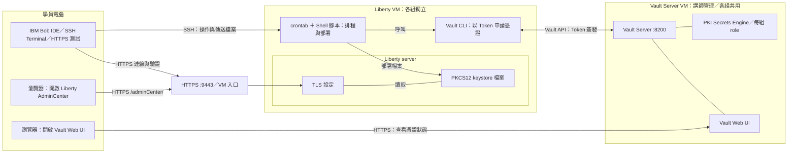

# Part 2｜Vault PKI ＋ Shell／crontab

[← 回組合總覽](../README.md) · [開啟分頁教材](../index.html#part-2)

**難度：中階｜總時間：60 分鐘｜適合：熟悉 Shell、想串接集中式簽發的維運人員**

## 主機部署架構



Bob 在學員電腦使用；部署工具與 Liberty 在該組 VM 執行。學員可透過瀏覽器開啟講師提供的 Vault UI 網址，查看權限內的憑證狀態。

## 操作前準備

在 Bob IDE Terminal 登入自己的 Liberty VM，以第 1 組為例：

```bash
# 在學員電腦查詢該組 SSH config 的有效 HostName；此例為第 1 組
ssh -G liberty1 | awk '$1 == "hostname" {print $2; exit}'
# 記下輸出的 VM IP，再登入同一台 VM
ssh liberty1
# 以下在 Liberty VM 執行，自行建立本課工作目錄
mkdir -p ~/clm-workshop
cd ~/clm-workshop
hostname
whoami
/opt/ibm/wlp/bin/server status defaultServer
openssl version
```

確認該組 Vault API 位址、信任 CA、PKI mount／role 與受限 Token 檔位置。Token 只從受限本機檔案讀取。

**先讓 Bob 確認實際環境：**

```text
請協助檢查 Liberty server.xml，確認是否已設定 HTTPS、port 與 keystore；若已有憑證才讀取其 SAN，並確認服務控制方式，只讀公開憑證與設定，不顯示私鑰或密碼。
請列出本路線所需檔案與認證的位置，缺少時先指出缺項，不要假設存在 env.sh、程式骨架或參考完成檔。工作目錄是現在建立的 ~/clm-workshop，產出腳本用明確參數，Token 從受限本機檔案讀取；請依確認結果給完整執行命令。
```

缺少 CA、role 或認證資料時，先向講師確認。後續程式與設定檔須先讓 Bob 產生、檢視，再執行。

### 部署前確認、部署後驗證

**開始時沒有 HTTPS 或憑證也可以做。** 部署前只檢查 Liberty 設定；已提供憑證才記錄舊序號。部署完成後，才檢查服務是否送出本次產生的憑證。

**Liberty VM IP 從學員電腦的 SSH config 查詢**（用前面的 `ssh -G liberty1`，其他組換自己的編號）。把輸出的實際 IP 用於憑證 IP SAN 與驗證的 `TLS_HOST`，不要把 SSH 別名當 IP，也不要在 VM 內假設有相同 SSH config。以下驗證函式在 Liberty VM 執行；另加入 `127.0.0.1` IP SAN，可供本機測試使用。不需要 DNS 名稱或 DNS challenge。

**給 Bob 的部署要求：**

```text
請支援首次部署與後續輪換兩種情況：沒有 keystore 或未設定 HTTPS 時，建立 PKCS12、補齊 Liberty 必要的 HTTPS／keyStore 設定；已有憑證才做到期判斷與舊檔備份。不要對不存在的憑證做日期判斷，首次部署也不能 skip。修改 server.xml 前先備份，保留原有其他功能與連接埠設定。啟動後比對線上與本次產出的 leaf 憑證指紋，並驗證 CA 信任與 IP SAN。
IP SAN 必須包含從 SSH config 查到的 Liberty VM IP，另加入 127.0.0.1，不使用 DNS challenge，不要求真實 DNS 名稱。所需路徑明確傳入腳本或設定，不依賴未提供的設定檔。
```

以下函式在目前 Terminal 定義一次；`record_baseline` 在步驟 1 使用，`check_cert` 在部署完成後使用。將 CA 與本次 leaf 路徑換成實際輸出位置後，才執行 `check_cert`。這些變數只供驗證使用。

<details>
<summary>展開設定與驗證函式：record_baseline／check_cert</summary>

```bash
set -o pipefail
TLS_HOST='填入學員電腦SSH config查到的Liberty VM IP'
TLS_PORT=9443 # 以實際設定為準
CA_FILE='/實際路徑/ca.crt'
LEAF_FILE='/實際路徑/server.crt'

record_baseline() (
  set -o pipefail
  # 僅記錄公開資訊，不宣稱舊憑證已通過信任驗證
  if timeout 10 openssl s_client -connect "${TLS_HOST}:${TLS_PORT}" \
      </dev/null 2>baseline-tls.log \
      | openssl x509 -noout -serial -issuer -dates > before.tmp; then
    mv before.tmp before.txt
    cat before.txt
  else
    rm -f before.tmp before.txt
    echo '尚未取得線上憑證，確認設定後走首次部署流程。'
  fi
)

check_cert() (
  set -euo pipefail
  : "${TLS_HOST:?}" "${TLS_PORT:?}" "${CA_FILE:?}" "${LEAF_FILE:?}"
  peer=$(timeout 10 openssl s_client \
    -connect "${TLS_HOST}:${TLS_PORT}" -verify_ip "$TLS_HOST" \
    -CAfile "$CA_FILE" -verify_return_error \
    </dev/null 2>tls-check.log | openssl x509 -outform PEM)
  expected=$(openssl x509 -in "$LEAF_FILE" -noout -fingerprint -sha256)
  actual=$(printf '%s\n' "$peer" | openssl x509 -noout -fingerprint -sha256)
  [ "$expected" = "$actual" ] || { echo '線上憑證與本次產出不一致' >&2; exit 1; }
  printf '%s\n' "$peer" | openssl x509 -noout -serial -issuer -dates -ext subjectAltName
  echo '驗證通過：TLS、CA 信任、IP SAN 與本次憑證指紋一致'
)
```

</details>

`record_baseline` 無法取得憑證時，先看設定與 `baseline-tls.log`，不直接認定憑證過期或信任有誤。`check_cert` 失敗則查看 `tls-check.log`；不能用忽略驗證的方式當作完成。

### Vault 簽發設定

確認該組 role 允許 IP SAN（`allow_ip_sans=true`），簽發請求的 `ip_sans` 帶入 SSH config 查到的 VM IP 與 `127.0.0.1`。純 IP 測試可由講師將該組 role 設為 `require_cn=false`，並省略 CN；若保留必填 CN，使用 role 允許的標籤並避免自動加入 DNS SAN（`exclude_cn_from_sans=true`）。共用 role 由講師確認，不由學員任意修改。這是私有 PKI 的 role 權限，不是 DNS challenge。

## 實作流程

### 1. 辨識現況｜5 分鐘

檢查 HTTPS／keystore 設定，有舊憑證才記錄；確認 Vault 內網連線及每組 role 名稱。

**給 Bob 的提示：**

```text
我是 SP／OP 人員，請先簡要解釋：
1. TLS 憑證生命週期的申請、核發、部署、監控、輪換與撤銷。
2. Liberty 的 JKS 與 PKCS12 有何差異，本次為何選 PKCS12。
3. 自動輪換與手動置換的風險差異。
4. Vault PKI Secrets Engine 在 CLM 的角色，以及 role 如何限制簽發。
5. Shell 如何向 Vault 申請憑證，crontab 如何觸發輪換。

再根據本次環境：
請根據環境設定解釋簽發 API、role 與 TTL；Token 只讀取本機受限檔案，不要要求我貼 Token。
```

**操作指令（Liberty VM）：**

```bash
vault version
record_baseline
```

**檢查點：** 基準資料與 API 路徑。

### 2. 取得配對憑證｜10 分鐘

使用已建好的 PKI role 申請一次憑證，拆分同一 JSON 回應中的 key、leaf 與完整 ca_chain。

**給 Bob 的提示：**

```text
請產生申請及拆檔腳本，從環境設定取得 Vault 位址、mount、role、CN 與 SAN。檢查 API 錯誤與必要欄位，將完整 ca_chain 輸出到 chain.pem，檔案權限只允許執行帳號讀取。
```

**操作指令（Liberty VM）：**

```bash
bash -n ./request-cert.sh
chmod 700 ./request-cert.sh
./request-cert.sh
# 檢查憑證與鏈，不顯示私鑰；路徑依產出的 staging 目錄調整
```

**檢查點：** 通過配對與鏈驗證的 PEM 檔。

### 3. 建立輪換腳本｜17 分鐘

補完到期判斷、強制模式、備份、轉檔與部署；保留 server.xml 的其他功能；未設定 HTTPS 時補齊所需設定。

**給 Bob 的提示：**

```text
請建立 cert-rotate.sh：一般模式尚未達自行設定的輪換門檻時略過，FORCE=true 才強制簽發；加互斥鎖。新憑證 TTL 自行設定但須符合該組 Vault role 上限，輪換門檻須小於 TTL，先在暫存目錄驗證配對及鏈並轉 PKCS12，再備份並原子替換 live keystore。使用已確認的服務控制方式重啟，驗證線上序號；失敗還原並恢復服務。Token 和 keystore 密碼從受限本機檔讀取，不寫入日誌。
```

**操作指令（Liberty VM）：**

```bash
bash -n ./cert-rotate.sh
chmod 700 ./cert-rotate.sh
```

**檢查點：** 可執行的 cert-rotate.sh。

### 4. 測試與排程｜13 分鐘

先 FORCE=true 完成換證，再跑一般模式確認 skip；新增每日 02:00 的 cron，保留原有排程。

**給 Bob 的提示：**

```text
請使用絕對路徑與明確設定檔產生 cron 項目，考慮 cron 的精簡環境與互斥鎖。安裝時保留現有 crontab；課堂手動執行同一命令驗證，不等待凌晨。
```

**操作指令（Liberty VM）：**

```bash
FORCE=true ./cert-rotate.sh
check_cert | tee after.txt
./cert-rotate.sh
# 第二次應顯示未達門檻，略過簽發與重啟
crontab -l
crontab -e
# 只新增本課排程，保留其他項目
crontab -l
```

**檢查點：** 部署驗證、skip 紀錄與 crontab。

### 5. 驗證排程執行環境｜10 分鐘

確認換證腳本在 cron 的精簡環境下仍可取得必要設定，憑證未到期時會 skip。

**給 Bob 的提示：**

```text
請檢查 cert-rotate.sh 是否依賴 Terminal 的環境變數，改為明確腳本參數及受限本機認證檔。不要假設存在 env.sh。請依實際參數提供 env -i 測試命令，包含必要 HOME、PATH 與 Vault CA 信任路徑；不使用 FORCE。確認結果 skip、不簽發、不重啟，並檢查退出碼與日誌。不要回顯 Token。
```

**操作指令（Liberty VM）：**

```bash
# 請 Bob 先補齊與 cron 相同的實際參數，再執行
# 必要參數接在 cert-rotate.sh 後；認證值只從受限本機檔案讀取
env -i HOME="$HOME" PATH=/usr/local/bin:/usr/bin:/bin \
  /bin/bash "$HOME/clm-workshop/cert-rotate.sh"
echo "exit code: $?"
check_cert
```

**檢查點：** 精簡環境手動測試成功，未到期時 skip。

### 6. 成果交付｜5 分鐘

提交腳本、排程與部署後憑證資訊（有舊憑證才附前後序號），說明 Token 到期後誰負責處理。

**給 Bob 的提示：**

```text
請依實測整理五行維運交接，列出排程、觸發門檻、驗證、恢復及 Token 到期限制。
```

**操作指令（Liberty VM）：**

```bash
check_cert | tee after.txt
if [ -s before.txt ]; then
  diff -u before.txt after.txt || true
else
  echo '首次部署：以線上與本次產出憑證一致作為驗收，不比較舊序號。'
fi
crontab -l
```

**檢查點：** 交接紀錄。


## crontab 設定範例

保留原有排程，將帳號、絕對路徑與必要腳本參數換成實際值：

```cron
0 2 * * * /bin/bash /home/ACCOUNT/clm-workshop/cert-rotate.sh >> /home/ACCOUNT/clm-workshop/cron.log 2>&1
```

Token 由腳本讀取受限本機檔案，不放在 cron 指令或日誌。課堂手動測試同一命令，不必等到凌晨。

## 60 分鐘內的完成標準

1. 首次部署：HTTPS 成功提供本次憑證，CA 信任與 IP SAN 驗證通過；已有憑證則另外比較換證部署後憑證資訊（有舊憑證才附前後序號）。
2. 重跑未到期時 skip；cron 已設定，精簡環境手動測試通過。
3. 留下程式／設定、部署後憑證資訊（有舊憑證才附前後序號）與簡短交接，不含秘密。

## 延伸練習（不計入 60 分鐘）

- Cheat sheet 參考：[Bob Cheat Sheet](https://owhc.github.io/bob-cheatsheet/bob-lite-ver.html)
- 使用測試複本或變數觸發錯誤，驗證失敗保護與部署失敗後還原。
- 完整 CA 建置、AGENTS.md、Slash Command、可重用 Skill、Frontend Slides 簡報與多台部署。

## Cheatsheet：實作流程與檢查點

| 時間 | 工作 | 檢查點 |
|---|---|---|
| 00–05 分 | 辨識現況 | 基準資料與 API 路徑。 |
| 05–15 分 | 取得配對憑證 | 通過配對與鏈驗證的 PEM 檔。 |
| 15–32 分 | 建立輪換腳本 | 可執行的 cert-rotate.sh。 |
| 32–45 分 | 測試與排程 | 部署驗證、skip 紀錄與 crontab。 |
| 45–55 分 | 驗證排程執行環境 | 精簡環境手動測試成功，未到期時 skip。 |
| 55–60 分 | 成果交付 | 交接紀錄。 |
