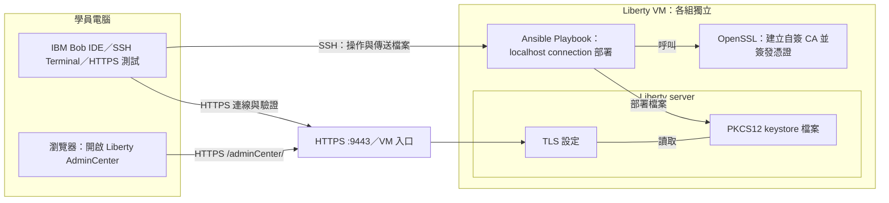

# Part 3｜OpenSSL ＋ Ansible

[← 回組合總覽](../README.md) · [開啟分頁教材](../index.html#part-3)

**難度：中高階｜總時間：60 分鐘｜適合：有基本 YAML／Ansible 經驗的平台工程師**

## 主機部署架構



Bob 在學員電腦使用；部署工具與 Liberty 在該組 VM 執行。

## 操作前準備

在 Bob IDE Terminal 登入自己的 Liberty VM，以第 1 組為例：

```bash
# 在學員電腦查詢該組 SSH config 的有效 HostName；此例為第 1 組
ssh -G liberty1 | awk '$1 == "hostname" {print $2; exit}'
# 記下輸出的 VM IP，再登入同一台 VM
ssh liberty1
# 以下在 Liberty VM 執行，自行建立本課工作目錄
mkdir -p ~/clm-workshop
cd ~/clm-workshop
hostname
whoami
/opt/ibm/wlp/bin/server status defaultServer
openssl version
```

規劃測試 CA 憑證與私鑰輸出位置，在步驟 2 自行建立。

**先讓 Bob 確認實際環境：**

```text
請先確認實際環境，只讀公開憑證與設定，不顯示私鑰或密碼：
1. 檢查 Liberty server.xml：HTTPS、port、keystore 設定，以及服務控制方式。
2. 讀取目前憑證的 SAN。
3. 列出本路線所需檔案與認證的位置；缺少的先指出缺項，不要假設存在 env.sh、程式骨架或參考完成檔。

工作目錄是 ~/clm-workshop；Ansible 用明確變數指定實際路徑。請依確認結果給完整執行命令。
```

測試 CA 由學員在步驟 2 建立，效期與輪換門檻自行決定；不需講師提供 CA。後續程式與設定檔須先讓 Bob 產生、檢視，再執行。

### 部署前確認、部署後驗證

**Liberty 目前已啟用 HTTPS，送出的是預設自簽憑證（`CN=localhost`，無 IP SAN）；本課要把它換成新憑證。** 部署前先用 `record_baseline` 記錄舊序號；部署完成後，用 `check_cert` 確認服務送出的是本次產生的憑證。

**Liberty VM IP 的取得與使用：**

- 在學員電腦用前面的 `ssh -G liberty1` 查詢（其他組換自己的編號）。
- 把輸出的 IP 用於憑證 IP SAN 與驗證用的 `TLS_HOST`；另加入 `127.0.0.1` IP SAN 供本機測試。
- 不要把 SSH 別名當 IP；VM 內也不要假設有相同的 SSH config。
- 不需要 DNS 名稱或 DNS challenge。

**給 Bob 的部署要求：**

```text
請依以下條件建立部署流程：

【現況】
- Liberty 已啟用 HTTPS，現有 resources/security/key.p12 是預設自簽憑證（CN=localhost）。
- 第一次部署就必須換成本次新憑證，不能因為已有憑證而 skip；之後的輪換才做到期判斷。

【憑證】
- IP SAN 包含 SSH config 查到的 Liberty VM IP 與 127.0.0.1。
- 不使用 DNS challenge，不要求真實 DNS 名稱。

【路徑與權限】
- 所有產出（憑證、金鑰、腳本、日誌）放在 /home/vpcuser/clm-workshop/，腳本一律用這個絕對路徑，不用 ~ 或 $HOME（cron 以 root 執行，root 的 HOME 是 /root）。
- 所需路徑明確傳入腳本或設定，不依賴未提供的設定檔。
- 公開憑證 0644（vpcuser 要能讀來驗證），私鑰 0600。

【Liberty 與 keystore】
- Liberty 以 root 執行；server.xml、server.env、resources/security/key.p12 都是 root 所有。
- vpcuser 可免密碼 sudo；讀寫與重啟 Liberty 都用 sudo（cron 內也要）。
- key.p12 的密碼在 server.env 的 keystore_password（server.xml 以 ${keystore.password} 引用）。新 PKCS12 沿用同一密碼並放回原路徑；只在腳本內讀取，不輸出、不寫進日誌。
- 替換前先備份舊 key.p12；若要改 server.xml 也先備份，保留其他功能與連接埠設定。

【驗證】
- 啟動後比對線上與本次產出的 leaf 憑證指紋，並驗證 CA 信任與 IP SAN。
```

**驗證函式使用方式：**

- 在 Liberty VM 的 Terminal 定義一次。
- `record_baseline` 在步驟 1 使用；`check_cert` 在部署完成後使用。
- 執行 `check_cert` 前，先確認CA 與本次 leaf的檔名與實際輸出一致。
- 這些變數只供驗證使用。

<details>
<summary>展開設定與驗證函式：record_baseline／check_cert</summary>

```bash
set -o pipefail
TLS_HOST='填入學員電腦SSH config查到的Liberty VM IP'
TLS_PORT=9443 # 以實際設定為準
CA_FILE='/home/vpcuser/clm-workshop/ca.crt' # Bob 產出後確認實際檔名
LEAF_FILE='/home/vpcuser/clm-workshop/server.crt' # 同上

record_baseline() (
  set -o pipefail
  # 僅記錄公開資訊，不宣稱舊憑證已通過信任驗證
  if timeout 10 openssl s_client -connect "${TLS_HOST}:${TLS_PORT}" \
      </dev/null 2>baseline-tls.log \
      | openssl x509 -noout -serial -issuer -dates > before.tmp; then
    mv before.tmp before.txt
    cat before.txt
  else
    rm -f before.tmp before.txt
    echo '無法取得線上憑證：請確認 Liberty 已啟動、TLS_HOST 與 TLS_PORT 正確，並查看 baseline-tls.log。'
  fi
)

check_cert() (
  set -euo pipefail
  : "${TLS_HOST:?}" "${TLS_PORT:?}" "${CA_FILE:?}" "${LEAF_FILE:?}"
  peer=$(timeout 10 openssl s_client \
    -connect "${TLS_HOST}:${TLS_PORT}" -verify_ip "$TLS_HOST" \
    -CAfile "$CA_FILE" -verify_return_error \
    </dev/null 2>tls-check.log | openssl x509 -outform PEM)
  expected=$(openssl x509 -in "$LEAF_FILE" -noout -fingerprint -sha256)
  actual=$(printf '%s\n' "$peer" | openssl x509 -noout -fingerprint -sha256)
  [ "$expected" = "$actual" ] || { echo '線上憑證與本次產出不一致' >&2; exit 1; }
  printf '%s\n' "$peer" | openssl x509 -noout -serial -issuer -dates -ext subjectAltName
  echo '驗證通過：TLS、CA 信任、IP SAN 與本次憑證指紋一致'
)
```

</details>

- `record_baseline` 無法取得憑證：先看設定與 `baseline-tls.log`，不直接認定憑證過期或信任有誤。
- `check_cert` 失敗：查看 `tls-check.log`；不能用忽略驗證的方式當作完成。

## 實作流程

### 1. 辨識現況｜5 分鐘

確認 Ansible 可用，檢查是否已有 HTTPS 與憑證，請 Bob 依實際環境建立 inventory 與變數檔。

**給 Bob 的提示：**

```text
我是 SP／OP 人員，請先簡要解釋：
1. TLS 憑證生命週期的申請、核發、部署、監控、輪換與撤銷。
2. Liberty 的 JKS 與 PKCS12 有何差異，本次為何選 PKCS12。
3. 自動輪換與手動置換的風險差異。
4. OpenSSL 自簽 CA 與伺服器憑證的關係，如何自行選擇效期與輪換門檻。
5. Ansible 如何重複執行並避免不必要的換證與重啟。

再根據本次環境：
請解釋這個 localhost inventory、tasks、handlers、block/rescue 的用途，指出本次哪些 task 會改動服務。
```

**操作指令（Liberty VM）：**

```bash
ansible --version
# 在該組 Liberty VM 建立本課 localhost inventory
printf 'localhost ansible_connection=local\n' > inventory
ansible -i inventory all -m ansible.builtin.ping
record_baseline
```

**檢查點：** 基準資訊與連線確認。

### 2. 建立簽發任務｜10 分鐘

用 Bob 建立測試 CA，再完成 server key、CSR、IP SAN 與簽發任務；CA 只在不存在時建立。

**給 Bob 的提示：**

```text
請產生單一 playbook.yml，需求如下：
- 工具：用 ansible.builtin 與已安裝的 OpenSSL；改動 Liberty 的 task 要加 become: true；產出檔放 /home/vpcuser/clm-workshop/。
- CA：路徑由 ca_cert_file、ca_key_file 變數指定；不存在時先建立自簽 CA（CA:true、keyCertSign），已存在則沿用。CA 私鑰只留在課堂 VM。
- 伺服器憑證：IP SAN 包含 SSH config 查到的 VM IP 與 127.0.0.1；CN 僅作標籤；每次輪換使用新序號。
- 效期：CA 與 leaf 效期自行設定，CA 效期需涵蓋 leaf。
- 錯誤：失敗時停止，不忽略錯誤。
```

**操作指令（Liberty VM）：**

```bash
ansible-playbook -i inventory playbook.yml --syntax-check
# 請 Bob 補完單一 Playbook 後再執行，語法檢查不會簽發憑證
```

**檢查點：** 可簽發且有 SAN 的憑證，CA 與 leaf 驗證通過（`openssl verify -CAfile ca.crt server.crt`）。

### 3. 完成部署與恢復｜17 分鐘

補上條件判斷、備份、PKCS12、受控重啟與 block/rescue。

**給 Bob 的提示：**

```text
請補完 playbook.yml：
- 條件：加入 force_rotate 變數（預設 false）與輪換門檻（自行設定，小於憑證效期）；未到期就略過。
- 部署：先在 staging 驗證 key 配對與鏈、轉 PKCS12，再備份並原子替換。
- 錯誤處理：用 block/rescue 包住替換、重啟與線上驗證；失敗就還原並恢復服務。
- handler：若使用 handler，需在驗證前 flush_handlers，不能等 play 結束才重啟。
- 機密：不要把秘密寫進 YAML 或 log。
```

**操作指令（Liberty VM）：**

```bash
ansible-playbook -i inventory playbook.yml --syntax-check
# 檢視 block/rescue、服務重啟與驗證順序
```

**檢查點：** 完整單檔 Playbook。

### 4. 執行與重跑｜13 分鐘

執行 syntax-check、強制輪換及一般重跑，確認第一次成功部署本次憑證、第二次略過。

**給 Bob 的提示：**

```text
請提供以下命令，並簡述用途：
- syntax-check
- force_rotate=true 的執行
- 一般模式的執行
另外解釋：為何不能只憑 --check 判定憑證簽發與服務重啟成功。
```

**操作指令（Liberty VM）：**

```bash
ansible-playbook -i inventory playbook.yml -e force_rotate=true
check_cert | tee after.txt
ansible-playbook -i inventory playbook.yml
# 第二次應略過簽發／替換／重啟相關任務
```

**檢查點：** Play recap、序號變更與 skip。

### 5. 檢查重複執行結果｜10 分鐘

比較強制輪換與一般執行的 Play recap，確認不需換證時不會重新簽發或重啟 Liberty。

**給 Bob 的提示：**

```text
請比較兩次執行的 tasks 與 changed／skipped 結果：
- 確認 force_rotate 預設為 false。
- 未到期時不應重新簽發、不替換 keystore、不觸發重啟。
- 若有不必要的 changed，請給最小修正，再重跑確認線上序號不變。
```

**操作指令（Liberty VM）：**

```bash
check_cert | tee rerun-before.txt
ansible-playbook -i inventory playbook.yml
check_cert | tee rerun-after.txt
diff -u rerun-before.txt rerun-after.txt
```

**檢查點：** 一般重跑不換證、不重啟，線上序號不變。

### 6. 成果交付｜5 分鐘

提交 inventory、變數範本、Playbook 與驗證紀錄。

**給 Bob 的提示：**

```text
請整理五行交接並說明擴成多台時需要增加哪些 inventory 與逐台驗證控制，不要在本次實作展開。
```

**操作指令（Liberty VM）：**

```bash
check_cert | tee after.txt
if [ -s before.txt ]; then
  diff -u before.txt after.txt || true
else
  echo '首次部署：以線上與本次產出憑證一致作為驗收，不比較舊序號。'
fi
# 提交 inventory、非機密變數範本、playbook.yml 與驗證摘要
```

**檢查點：** 交接紀錄。

## 60 分鐘內的完成標準

1. 首次部署：HTTPS 成功提供本次憑證，CA 信任與 IP SAN 驗證通過；已有憑證則另外比較換證部署後憑證資訊（有舊憑證才附前後序號）。
2. 一般重跑不重新簽發、不替換 keystore、不重啟服務。
3. 留下程式／設定、部署後憑證資訊（有舊憑證才附前後序號）與簡短交接，不含秘密。
4. 瀏覽器開啟 `https://<IP>:9443/adminCenter/`（`admin`／`admin123456`），檢視網址列憑證，序號與 `check_cert` 一致；自簽或私有 CA 憑證的瀏覽器警告屬預期。

## 延伸練習（不計入 60 分鐘）

- 使用測試複本或變數觸發錯誤，驗證失敗保護與部署失敗後還原。
- 進階 CA 階層建置、AGENTS.md、Slash Command、可重用 Skill、Frontend Slides 簡報與多台部署。

## Cheatsheet：實作流程與檢查點

| 時間 | 工作 | 檢查點 |
|---|---|---|
| 00–05 分 | 辨識現況 | 基準資訊與連線確認。 |
| 05–15 分 | 建立簽發任務 | 可簽發且有 SAN 的憑證。 |
| 15–32 分 | 完成部署與恢復 | 完整單檔 Playbook。 |
| 32–45 分 | 執行與重跑 | Play recap、序號變更與 skip。 |
| 45–55 分 | 檢查重複執行結果 | 一般重跑不換證、不重啟，線上序號不變。 |
| 55–60 分 | 成果交付 | 交接紀錄。 |
