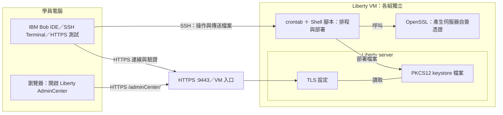

# Part 4｜OpenSSL ＋ Shell／crontab

[← 回組合總覽](../README.md) · [開啟分頁教材](../index.html#part-4)

**難度：⭐ 入門｜總時間：60 分鐘**

## 主機部署架構



Bob 在學員電腦使用；OpenSSL、Shell 與 crontab 在 Liberty VM 執行。PKCS12 是 Liberty 使用的檔案，9443 是該 VM 的 HTTPS 入口。

## 操作前準備

在 Bob IDE Terminal 登入自己的 Liberty VM，第 1 組範例：

```bash
# 在學員電腦查詢該組 SSH config 的有效 HostName；此例為第 1 組
ssh -G liberty1 | awk '$1 == "hostname" {print $2; exit}'
# 記下輸出的 VM IP，再登入同一台 VM
ssh liberty1
# 以下在 Liberty VM 執行；自行建立本課工作目錄
mkdir -p ~/clm-workshop
cd ~/clm-workshop
hostname
whoami
/opt/ibm/wlp/bin/server status defaultServer
openssl version
```

本 Part 直接產生 **伺服器自簽憑證**，由伺服器自己的私鑰簽署，不另外建立 CA 或 CA 憑證。憑證效期與輪換門檻自行決定，門檻需小於效期。

### 部署前確認、部署後驗證

**Liberty 目前已啟用 HTTPS，送出的是預設自簽憑證（`CN=localhost`，無 IP SAN）；本課要把它換成新憑證。** 部署前先用 `record_baseline` 記錄舊序號；部署完成後，用 `check_cert` 確認服務送出的是本次產生的憑證。

**Liberty VM IP 的取得與使用：**

- 在學員電腦用前面的 `ssh -G liberty1` 查詢（其他組換自己的編號）。
- 把輸出的 IP 用於憑證 IP SAN 與驗證用的 `TLS_HOST`；另加入 `127.0.0.1` IP SAN 供本機測試。
- 不要把 SSH 別名當 IP；VM 內也不要假設有相同的 SSH config。
- 不需要 DNS 名稱或 DNS challenge。

**給 Bob 的部署要求：**

```text
請依以下條件建立部署流程：

【現況】
- Liberty 已啟用 HTTPS，現有 resources/security/key.p12 是預設自簽憑證（CN=localhost）。
- 第一次部署就必須換成本次新憑證，不能因為已有憑證而 skip；之後的輪換才做到期判斷。

【憑證】
- IP SAN 包含 SSH config 查到的 Liberty VM IP 與 127.0.0.1。
- 不使用 DNS challenge，不要求真實 DNS 名稱。

【路徑與權限】
- 所有產出（憑證、金鑰、腳本、日誌）放在 /home/vpcuser/clm-workshop/，腳本一律用這個絕對路徑，不用 ~ 或 $HOME（cron 以 root 執行，root 的 HOME 是 /root）。
- 所需路徑明確傳入腳本或設定，不依賴未提供的設定檔。
- 公開憑證 0644（vpcuser 要能讀來驗證），私鑰 0600。

【Liberty 與 keystore】
- Liberty 以 root 執行；server.xml、server.env、resources/security/key.p12 都是 root 所有。
- vpcuser 可免密碼 sudo；讀寫與重啟 Liberty 都用 sudo（cron 內也要）。
- key.p12 的密碼在 server.env 的 keystore_password（server.xml 以 ${keystore.password} 引用）。新 PKCS12 沿用同一密碼並放回原路徑；只在腳本內讀取，不輸出、不寫進日誌。
- 替換前先備份舊 key.p12；若要改 server.xml 也先備份，保留其他功能與連接埠設定。

【驗證】
- 啟動後比對線上與本次產出的 leaf 憑證指紋，並以本次自簽憑證作為明確信任依據驗證 IP SAN。
```

**驗證函式使用方式：**

- 在 Liberty VM 的 Terminal 定義一次。
- `record_baseline` 在步驟 1 使用；`check_cert` 在部署完成後使用。
- 執行 `check_cert` 前，先確認本次伺服器憑證的檔名與實際輸出一致。
- 這些變數只供驗證使用。

<details>
<summary>展開設定與驗證函式：record_baseline／check_cert</summary>

```bash
set -o pipefail
TLS_HOST='填入學員電腦SSH config查到的Liberty VM IP'
TLS_PORT=9443 # 以實際設定為準
CERT_FILE='/home/vpcuser/clm-workshop/server.crt' # 本次產生的伺服器自簽憑證；Bob 產出後確認實際檔名

record_baseline() (
  set -o pipefail
  # 僅記錄公開資訊，不宣稱舊憑證已通過信任驗證
  if timeout 10 openssl s_client -connect "${TLS_HOST}:${TLS_PORT}" \
      </dev/null 2>baseline-tls.log \
      | openssl x509 -noout -serial -issuer -dates > before.tmp; then
    mv before.tmp before.txt
    cat before.txt
  else
    rm -f before.tmp before.txt
    echo '無法取得線上憑證：請確認 Liberty 已啟動、TLS_HOST 與 TLS_PORT 正確，並查看 baseline-tls.log。'
  fi
)

check_cert() (
  set -euo pipefail
  : "${TLS_HOST:?}" "${TLS_PORT:?}" "${CERT_FILE:?}"
  peer=$(timeout 10 openssl s_client \
    -connect "${TLS_HOST}:${TLS_PORT}" -verify_ip "$TLS_HOST" \
    -CAfile "$CERT_FILE" -check_ss_sig -verify_return_error \
    </dev/null 2>tls-check.log | openssl x509 -outform PEM)
  expected=$(openssl x509 -in "$CERT_FILE" -noout -fingerprint -sha256)
  actual=$(printf '%s\n' "$peer" | openssl x509 -noout -fingerprint -sha256)
  [ "$expected" = "$actual" ] || { echo '線上憑證與本次產出不一致' >&2; exit 1; }
  printf '%s\n' "$peer" | openssl x509 -noout -serial -issuer -dates -ext subjectAltName
  echo '驗證通過：TLS、明確信任的自簽憑證、IP SAN 與本次憑證指紋一致'
)
```

</details>

- `record_baseline` 無法取得憑證：先看設定與 `baseline-tls.log`，不直接認定憑證過期或信任有誤。
- `check_cert` 失敗：查看 `tls-check.log`；不能用忽略驗證的方式當作完成。

## 實作流程

### 1. 辨識現況｜5 分鐘

先用 Bob 釐清自簽憑證與換證流程，再檢查這台 VM 的 HTTPS／keystore 設定，記錄預設憑證的序號。

**給 Bob 的提示：**

```text
我是 SP／OP 人員，請先簡要解釋：
1. TLS 憑證生命週期的申請、核發、部署、監控、輪換與撤銷。
2. Liberty 的 JKS 與 PKCS12 有何差異，本次為何選 PKCS12。
3. 自動輪換與手動置換的風險差異。
4. 伺服器自簽憑證如何用自己的私鑰簽署，為何不需另外建立 CA，以及如何選擇效期與輪換門檻。
5. Shell 與 crontab 如何檢查到期並執行輪換。

再根據本次環境：
請檢查本組 Liberty 的 server.xml、執行狀態與既有公開憑證，列出：
- HTTPS 是否啟用、port、keystore 路徑及格式。
- 目前憑證的序號、SAN 與到期日。
- 本次 server.crt、server.key、keystore.p12 的規劃路徑及服務控制方式。
不要顯示私鑰或密碼，也不要假設已有 env.sh 或程式骨架。
```

**操作指令（Liberty VM）：**

```bash
openssl version
record_baseline
```

**檢查點：** 理解自簽流程，取得本組 HTTPS／keystore 現況與檔案路徑。

### 2. 產生伺服器憑證｜10 分鐘

讓 Bob 直接產生私鑰與帶 IP SAN 的伺服器自簽憑證；效期自行選擇，驗證自簽簽章與私鑰配對。

**給 Bob 的提示：**

```text
請產生 issue-cert.sh，需求如下：
- 方式：直接用 openssl req -x509 建立 server.key 與伺服器自簽 server.crt；不建立 CA，不產生 ca.crt／ca.key，也不需要 CSR 送簽流程。
- 憑證屬性：basicConstraints=critical,CA:FALSE、適合 TLS server 的 keyUsage、extendedKeyUsage=serverAuth。
- 名稱：CN 僅作標籤；IP SAN 包含 SSH config 查到的 VM IP 與 127.0.0.1。
- 參數：效期、IP、輸出路徑用參數傳入；輸出到 /home/vpcuser/clm-workshop/：server.key（0600）、server.crt（0644）；每次產生新憑證都使用新序號。
- 安全：使用 umask 077；檢查自簽簽章、IP SAN 與私鑰配對，不顯示私鑰。
```

**操作指令（Liberty VM）：**

```bash
bash -n ./issue-cert.sh
chmod 700 ./issue-cert.sh
./issue-cert.sh
# 請 Bob 依實際輸出目錄提供 自簽簽章、IP SAN 與私鑰配對驗證命令
```

**檢查點：** 通過驗證的 server.crt 與 server.key。

### 3. 建立換證腳本｜17 分鐘

整合到期判斷、PKCS12 轉換、備份與部署，避免只有單次產生憑證就結束。

**給 Bob 的提示：**

```text
請建立 cert-rotate.sh，需求如下：
- 模式：FORCE 預設 false；輪換門檻由我設定（小於憑證效期）。未達門檻就 skip；達門檻或 FORCE=true 時，先呼叫 issue-cert.sh 產生新的 server.key／server.crt（序號必須改變），再部署。
- 互斥：用 flock，避免排程與手動換證同時執行。
- 部署：在暫存目錄先驗證自簽憑證及私鑰配對，再將 server.crt＋server.key 轉 PKCS12（不加 CA 鏈）；備份後原子替換（同一檔案系統內先完成新檔，再 rename）。
- 重啟與驗證：受控重啟 Liberty，確認線上序號；部署失敗就還原並恢復服務。
- 設定：保留 server.xml 其他功能，必要時補齊 HTTPS 設定；密碼讀取受限本機檔。
- 錯誤：每個步驟明確處理失敗。
```

**操作指令（Liberty VM）：**

```bash
bash -n ./cert-rotate.sh
chmod 700 ./cert-rotate.sh
```

**檢查點：** 可執行腳本與備份。

#### 這三個設定是什麼？

| 設定 | 用途 | 本課怎麼用 |
|---|---|---|
| 互斥鎖 | 排程與手動換證撞在一起時，只讓一份腳本執行，避免同時覆蓋檔案或重啟 | 用同一個 `flock` 鎖保護整段換證流程 |
| 原子替換 | 先把新 PKCS12 完整產生並驗證，再一次切換檔名，避免 Liberty 讀到寫了一半的檔案 | 暫存檔放在目標檔案同一個檔案系統；它不等於免重啟或自動 rollback |
| `FORCE=true` | 暫時略過「未到輪換門檻就 skip」的判斷，方便課堂測試 | 只用在 `cert-rotate.sh` 的手動測試；一般執行與 cron 不加，且仍須做完整驗證 |

`FORCE` 是本課要求 Bob 寫進腳本的自訂環境變數，不是 Shell 或 OpenSSL 內建功能；`FORCE=true ./cert-rotate.sh` 只對這一次執行生效。本課第一次換掉未到期的預設憑證時需要它；產生憑證的 `issue-cert.sh` 不需要。

### 4. 實測與排程｜13 分鐘

預設憑證尚未到期，所以第一次要用 `FORCE=true` 換掉它；完成後一般重跑應 skip，並加入每日 02:00 排程。

**給 Bob 的提示：**

```text
請產生 cron 排程（每日 02:00）：
- 以 root 的 crontab 安裝，保留現有項目。
- 腳本與產出一律用 /home/vpcuser/clm-workshop/ 絕對路徑，並帶明確的腳本參數。
- 用與 cron 相同的精簡環境手動測試，確認不依賴互動 shell 的環境變數。
```

**操作指令（Liberty VM）：**

```bash
# 預設憑證未到期，第一次用 FORCE 強制換證
FORCE=true ./cert-rotate.sh
check_cert | tee after.txt
./cert-rotate.sh
# 第二次應 skip
# cron 要以 root 執行（腳本需 sudo 操作 Liberty）：先切換成 root
sudo -i
crontab -l
# 請 Bob 提供不開編輯器的安裝命令（讀出現有 crontab 再附加本課排程），保留其他項目
crontab -l
exit   # 回到 vpcuser
```

**檢查點：** 線上新序號、skip 與 cron 設定。

### 5. 驗證排程執行環境｜10 分鐘

確認腳本在 cron 的精簡環境下仍可執行，檢查日誌與 skip 結果。

**給 Bob 的提示：**

```text
請檢查 cert-rotate.sh 能否在 cron 的精簡環境執行：
- 確認它不依賴互動 Terminal 的環境變數；改用明確腳本參數與絕對路徑，不要假設存在 env.sh。
- 提供 env -i 的手動測試命令，保留必要的 HOME、PATH 與實際參數；不使用 FORCE。
- 預期結果：未到期就 skip；檢查退出碼與日誌，不應重新簽發或重啟 Liberty。
```

**操作指令（Liberty VM）：**

```bash
# 先請 Bob 依實際腳本參數補齊測試命令，再執行
# 以下適用腳本已具備明確參數或已確認的非機密預設值
# 若需參數，須加在 cert-rotate.sh 後，與 cron 完全一致
# 模擬 root 的 cron 環境；腳本放在 vpcuser 的工作目錄，用絕對路徑
sudo env -i HOME=/root PATH=/usr/local/bin:/usr/bin:/bin \
  /bin/bash /home/vpcuser/clm-workshop/cert-rotate.sh
echo "exit code: $?"
check_cert
```

**檢查點：** 精簡環境執行成功，未到期時 skip，線上服務正常。

### 6. 成果交付｜5 分鐘

提交簽發腳本、輪換腳本、排程與部署後憑證資訊（附換證前後序號）。

**給 Bob 的提示：**

```text
請根據實測整理五行交接，包含換證條件、憑證與私鑰位置、PKCS12 路徑、驗證及恢復方式。
```

**操作指令（Liberty VM）：**

```bash
check_cert | tee after.txt
# 預設憑證 vs 新憑證：序號應不同
diff -u before.txt after.txt || true
sudo crontab -l
```

**檢查點：** 交接紀錄。

## crontab 設定範例

排程裝在 root 的 crontab（先 `sudo -i` 切換成 root）；保留原有排程，腳本路徑為 vpcuser 的工作目錄，必要腳本參數換成該組實際值：

```cron
0 2 * * * /bin/bash /home/vpcuser/clm-workshop/cert-rotate.sh >> /home/vpcuser/clm-workshop/cron.log 2>&1
```

腳本需有到期判斷、互斥鎖與日誌，且不能依賴目前 Terminal 的變數。課堂以相同指令手動測試，不必等到凌晨。

## 60 分鐘內的完成標準

1. Liberty HTTPS 提供本次自簽憑證，IP SAN 與憑證指紋驗證通過。
2. 一般重跑未達門檻時 skip；cron 已設定，精簡環境手動測試通過。
3. 留下腳本、排程、部署後憑證資訊與簡短交接；附換證前後序號。
4. 瀏覽器開啟 `https://<IP>:9443/adminCenter/`（`admin`／`admin123456`），檢視網址列憑證，序號與 `check_cert` 一致；自簽或私有 CA 憑證的瀏覽器警告屬預期。

## 延伸練習（不計入 60 分鐘）

- 以錯誤憑證路徑測試失敗保護，確認不覆蓋線上 keystore；進一步練習部署失敗後還原。
- AGENTS.md、Slash Command、可重用 Skill 。

## Cheatsheet：實作流程與檢查點

| 時間 | 工作 | 檢查點 |
|---|---|---|
| 00–05 分 | 辨識現況 | 找出憑證／keystore 路徑，記錄預設憑證序號 |
| 05–15 分 | 產生憑證 | 自簽簽章、IP SAN 與私鑰配對正確 |
| 15–32 分 | 建立換證腳本 | 語法通過，具到期判斷及備份 |
| 32–45 分 | 實測與排程 | 序號變更、重跑 skip、cron 已設定 |
| 45–55 分 | 驗證排程環境 | 精簡環境執行成功，服務正常 |
| 55–60 分 | 成果交付 | 腳本、排程與部署後憑證資訊（附換證前後序號）齊全 |
